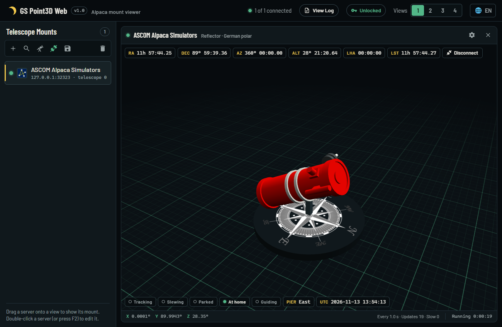

# GS Point3D Web

[](https://github.com/rmorgan001/GS.Point3DWeb/actions/workflows/build.yml)

A browser-based 3D viewer for telescope mounts. GS Point3D Web connects to ASCOM Alpaca
servers on the network, or to ASCOM COM drivers on the computer it runs on. It then shows each
mount as a live 3D model that moves as the mount does, so you can see where the telescope is
pointing from any browser.



## Features

- **Live 3D model:** follows the mount's axes, using the same model transform as GSServer.
  Supports German equatorial, fork (polar) and Alt-Az mounts in either hemisphere.
- **Telescope models:** reflector, refractor, Schmidt-Cassegrain, Ritchey-Chrétien (tube or
  truss), dual telescope and a default model, in any colour, with optional sky backgrounds and
  a ground grid.
- **Up to four views at once:** each view can show a different mount. Up to five servers can be
  added without a feature key.
- **Coordinates over the model:** RA, Dec, Az, Alt, LHA and LST, each one optional. RA can be
  shown in hours or degrees.
- **Mount state:** for servers that support `devicestate` (ASCOM Platform 7 / ITelescopeV4),
  a strip shows tracking, slewing, parked, at home, guiding, side of pier and the mount's UTC
  time. Older servers are read one property at a time.
- **Two ways to connect:**
  - Alpaca servers, found automatically with Alpaca discovery (UDP port 32227) or added by
    address.
  - ASCOM COM drivers, chosen from the drivers installed on the computer running the app
    (Windows only).
- **Saved camera views:** per mount, plus each mount's own polling interval (0.5–5 s).
- **Languages:** English, Deutsch, Español, Français, Italiano and 中文.
- **Works offline:** fonts and the 3D engine are bundled, so no internet connection is needed.
- **Logging:** a daily log file and a built-in log viewer, opened with **Log** in the top
  bar.
- **Built-in help:** a user guide in each of the app's languages, opened with the **?** button in
  the top bar.

## Requirements

- Nothing extra to run a [release](https://github.com/rmorgan001/GS.Point3DWeb/releases): each
  download includes .NET. To build from source, the
  [.NET 10 SDK](https://dotnet.microsoft.com/download/dotnet/10.0).
- Windows, for ASCOM COM drivers (with the
  [ASCOM Platform](https://ascom-standards.org/) installed). Alpaca servers work on any
  operating system .NET supports.
- A browser with WebGL.

## Download

Each [release](https://github.com/rmorgan001/GS.Point3DWeb/releases) has a download for each
platform, named `GS.Point3DWeb-<version>-<platform>`:

| Platform | For |
| --- | --- |
| `win-x64` (.zip) | Windows (Intel / AMD) |
| `win-arm64` (.zip) | Windows on ARM |
| `linux-x64` (.tar.gz) | Linux (Intel / AMD) |
| `linux-arm64` (.tar.gz) | Linux on 64-bit ARM, such as a Raspberry Pi with a 64-bit OS |
| `osx-x64` (.tar.gz) | macOS on Intel |
| `osx-arm64` (.tar.gz) | macOS on Apple silicon |

Extract it and run `GS.Point3DWeb` (`GS.Point3DWeb.exe` on Windows). It opens
<http://localhost:5000> in your default browser once it has started. It doesn't when it runs as a
service, in a container or on Linux without a desktop; to stop it opening the browser, set
`"OpenBrowser": false` in `appsettings.json` or start it with `--OpenBrowser=false`.

The downloads aren't code-signed, so the operating system may warn about them the first time:

- **Windows** ("Windows protected your PC"): click **More info**, then **Run anyway**. To stop the
  warning for good, unblock the download before extracting it: right-click the `.zip`, choose
  **Properties**, tick **Unblock** and click **OK**. For a folder that's already extracted, run this in
  PowerShell:

  ```powershell
  Get-ChildItem -Recurse "C:\path\to\GS.Point3DWeb-<version>-win-x64" | Unblock-File
  ```

- **macOS** ("cannot be opened because the developer cannot be verified"): run
  `xattr -dr com.apple.quarantine` on the extracted folder.

To use another port, or to open the app from other computers on the network, change the address it
listens on. Either set `Urls` in `appsettings.json`, next to the app (the default is
`http://localhost:5000`), or give it when you start the app, which overrides the file:

```shell
GS.Point3DWeb --urls "http://0.0.0.0:5000"
```

Anyone who can reach that address can connect and disconnect your mounts, so only do this on a
network you trust.

### Upgrading

Your settings aren't kept in the app's folder (see [Where things are stored](#where-things-are-stored)),
so a new version keeps your servers, views, view settings and saved cameras:

1. Stop the running app.
2. Extract the new download, into a new folder (safest: the old version still works if you need it)
   or over the old one.
3. If you changed `appsettings.json` (for example `Urls`), make the same change in the new copy:
   extracting over the old folder replaces it with the default.
4. Start the new version and open the same address.

Run only one copy at a time, as they share the same settings. Your language choice is kept by the
browser for each address, so it stays as long as the address and port don't change. The first time
a newer version starts, it copies `servers.json` to a backup folder before saving anything (see
[Where things are stored](#where-things-are-stored)).

## Running from source

```shell
git clone https://github.com/rmorgan001/GS.Point3DWeb.git
cd GS.Point3DWeb
dotnet run --project GS.Point3DWeb
```

Then open <http://localhost:5181>.

On its first run the app adds a connection to the
[ASCOM Alpaca Simulators](https://github.com/ASCOMInitiative/ASCOM.Alpaca.Simulators) at
`http://127.0.0.1:32323`. To view a mount:

1. Add it with **+** (by address), the discovery button (Alpaca servers on the network) or the
   ASCOM drivers button (COM drivers).
2. Drag it onto a view. Dragging connects it.
3. Use the cog on a view to choose the model, colours, background, coordinates and camera.

### Building

```shell
dotnet publish GS.Point3DWeb/GS.Point3DWeb.csproj --configuration Release --output publish
```

Every push to `main` is also built by [GitHub Actions](.github/workflows/build.yml). Each run
keeps the published app as a downloadable artifact for 14 days.

### Making a release

Push a version tag:

```shell
git tag v1.0.0
git push origin v1.0.0
```

The [release workflow](.github/workflows/release.yml) then builds the app for all six platforms
at once, and attaches them, with a `SHA256SUMS.txt` checksum file, to a GitHub Release for that
tag. Its notes list the changes since the last release. The tag sets the version shown in the
app. Every release is currently published as a pre-release.

The release is published as soon as the Windows and Linux builds finish. The macOS downloads are
added when their builds finish, as GitHub's macOS build machines are sometimes slow to start or
never start. If one is missing, the run ends in a failure: use **Re-run failed jobs** on it to
build and add the missing download. A tag can also be released again by hand from the Actions
tab (**Release** > **Run workflow**).

Other builds (local builds, `dotnet run` and the build on each push) show the newest version tag
plus the number of commits since it, such as `v1.0.1+3`, so the version never needs editing by
hand.

## Where things are stored

| What | Windows | Linux / macOS |
| --- | --- | --- |
| Server list and view settings (`servers.json`) | `%APPDATA%\GS.Point3DWeb` | `~/.config/GS.Point3DWeb` |
| Feature key (`feature.key`) | `%APPDATA%\GS.Point3DWeb` | `~/.config/GS.Point3DWeb` |
| Backups of `servers.json`, made when a newer version first starts (`servers-<old version>-<date>.json`) | `Documents\GS.Point3DWeb\Backups` | `~/.config/GS.Point3DWeb/backups` |
| Log files (`point3dweb-yyyyMMdd.log`, the last 14 files kept, up to 20 MB each) | `Documents\GS.Point3DWeb` | `~/.config/GS.Point3DWeb/logs` |

If the Documents folder can't be written (for example because of Windows Security's
Controlled folder access), the logs go to `%APPDATA%\GS.Point3DWeb\logs` instead. Warnings and
errors also go to the Windows Event Log.

## Repository layout

| Path | Contents |
| --- | --- |
| `GS.Point3DWeb/` | The web app (Blazor Server, MVVM with CommunityToolkit.Mvvm). |
| `GS.Point3DWeb/wwwroot/model3d/` | The Babylon.js viewer, the trimmed Babylon bundle and the `.obj` models. |
| `tools/babylon-bundle/` | Rebuilds the trimmed Babylon.js bundle. Only needed when changing it (see its README). |
| `tools/GS.Point3DWeb.KeyGen/` | Issues feature keys. Its private signing key is kept outside the repository and must never be shipped with the app. |

## Credits

- The telescope models and the mount transform are ported from Green Swamp's GSServer.
- Built with [ASCOM Alpaca and COM components](https://github.com/ASCOMInitiative),
  [Babylon.js](https://www.babylonjs.com/) and [Serilog](https://serilog.net/).
- The Barlow fonts are used under the [SIL Open Font License](GS.Point3DWeb/wwwroot/fonts/OFL.txt).
